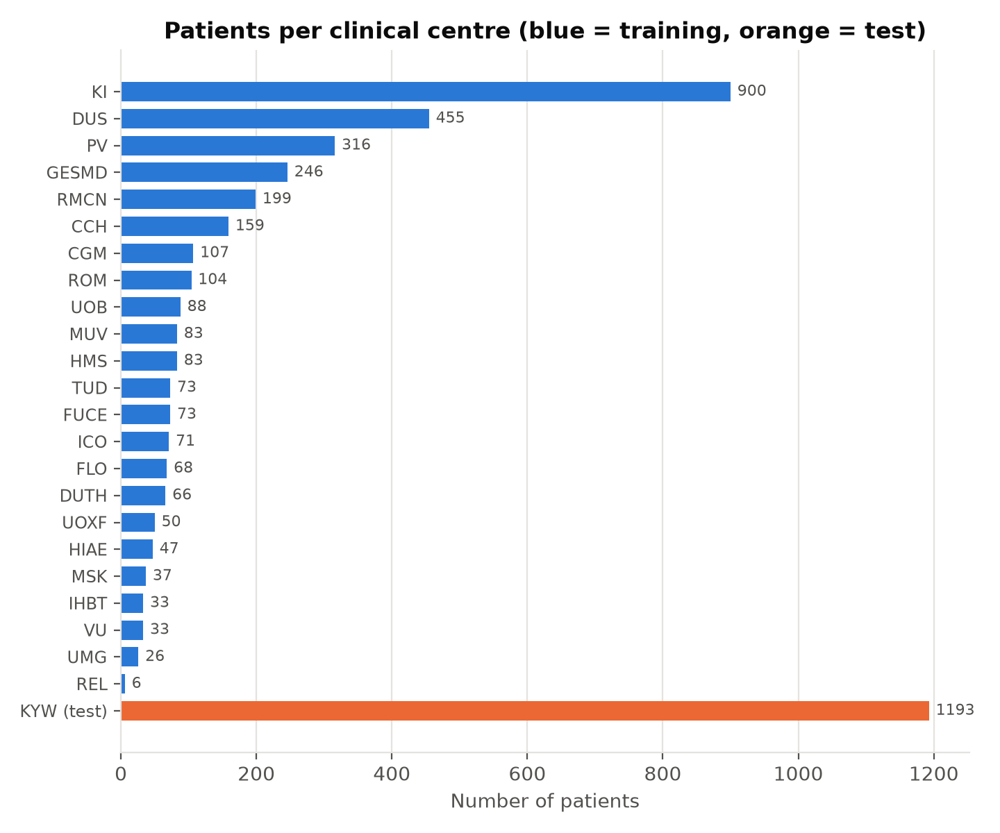
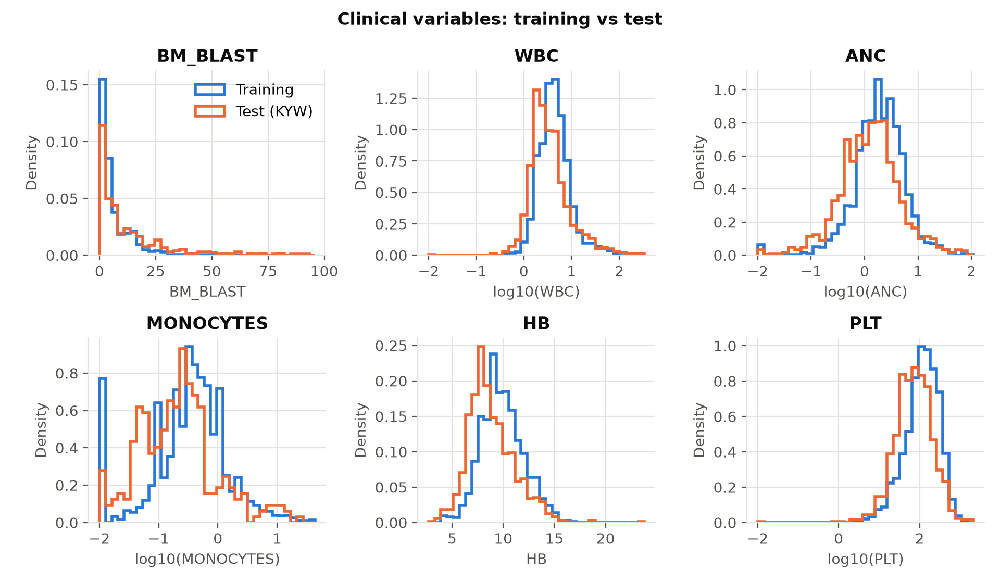

# Overall Survival Prediction in Myeloid Leukemia

Predicting how long patients with adult myeloid leukemia survive, from blood counts,
chromosome (cytogenetic) reports and gene mutations, using survival analysis:
Kaplan–Meier curves, Cox regression, and machine-learning survival models.

This is my entry to the **QRT × Institut Gustave Roussy data challenge** on
[Challenge Data (ENS Paris)](https://challengedata.ens.fr/challenges/162).

**Author:** Bernard Frimpong — M.S. Applied Mathematics (University of Akron, 2026)

---

## The problem in one paragraph

Each patient has an observed time `OS_YEARS` and a status `OS_STATUS`
(1 = died, 0 = still alive at last follow-up, called *censored*). For censored
patients we only know they survived *at least* `OS_YEARS`. The task is to give
every test patient a **risk score**: a higher score means we expect them to die
sooner. Only the **ranking** of the scores matters.

## How the challenge scores a submission

The metric is the **IPCW concordance index** (Uno's C-index), truncated at
**7 years**, computed with `sksurv.metrics.concordance_index_ipcw`.

- Look at every pair of patients where we know who died first.
- Count the share of those pairs where the model gave the higher risk to the patient who died first.
- 0.5 = random guessing, 1.0 = perfect ranking.
- "IPCW" (inverse probability of censoring weighting) gives more weight to pairs
  that were less likely to be observed, which corrects the bias caused by censoring.

## Data

| File | Rows | What it contains |
|---|---|---|
| `clinical_train.csv` | 3,323 | one row per patient: centre, blood counts, cytogenetics text |
| `clinical_test.csv` | 1,193 | same, for the test patients |
| `molecular_train.csv` | 10,935 | one row per somatic mutation (gene, effect, VAF, depth) |
| `molecular_test.csv` | 3,089 | same, for the test patients |
| `target_train.csv` | 3,323 | `OS_YEARS`, `OS_STATUS` |

The data are **not** included in this repository (Challenge Data terms of use).
To reproduce the work, register for the challenge and place the five files in `data/raw/`.

## Key findings so far (Stage 1 — data audit)

1. **The test set is one new hospital.** All 1,193 test patients come from centre
   `KYW`, which never appears in the 23 training centres. So the usual random
   cross-validation would be too optimistic; I will hold out *whole centres*
   (grouped cross-validation) to imitate the real test situation.
2. **The test patients are sicker.** Compared with training, the test centre has
   more patients with bone-marrow blasts above 20% (17.6% vs 4.2%), lower
   platelets (median 74 vs 123 G/L) and lower haemoglobin (8.4 vs 9.7 g/dL),
   and more than twice the rate of **TP53** mutations (25.7% vs 11.4%).
3. **150 training patients have no outcome** and are removed before modelling,
   leaving 3,173 patients: 1,600 deaths (50.4%) and 1,573 censored (49.6%).
4. **Monocyte counts are missing for 74% of test patients** (18% in training),
   so models should not rely heavily on that variable.
5. **The cytogenetics text is written differently in the two sets**: lower case
   (`46,xy`) in training, upper case (`46,XY`) or the word `Normal` in the test set.
   Feature extraction must normalise this first.
6. **19 genes appear only in the test set**, so a model trained on training genes
   cannot use them.





## Project structure

```
aml-survival-prediction/
├── README.md
├── requirements.txt
├── .gitignore
├── data/
│   ├── raw/            <- the 5 challenge CSV files go here (not on GitHub)
│   └── processed/      <- cleaned tables created by later stages
├── src/
│   ├── config.py           paths, 7-year horizon, random seed, colours
│   ├── load_data.py        functions that read the 5 files
│   ├── 01_check_setup.py   Stage 0: checks Python, packages and data files
│   └── 02_data_audit.py    Stage 1: data audit, 5 figures, 4 tables
├── figures/            <- PNG figures (used by the README and the paper)
├── results/tables/     <- CSV/TXT summaries
├── submissions/        <- files uploaded to Challenge Data (kept local)
└── paper/
    └── main.tex        <- LaTeX write-up, updated at every stage
```

## How to run (Windows, VS Code terminal)

```bash
py -3.13 -m venv .venv
.venv\Scripts\activate
python -m pip install --upgrade pip
pip install -r requirements.txt
pip install --no-deps scikit-survival
python src/01_check_setup.py
python src/02_data_audit.py
```

**Why `--no-deps` for scikit-survival?** It lists `ecos` as a dependency, but `ecos`
has no ready-made Windows package for Python 3.13 and would need Microsoft C++ Build
Tools to compile. `ecos` is only used by one survival-SVM function that this project
does not use, so scikit-survival is installed without it.

## Stage plan and progress

| Stage | Content | Status |
|---|---|---|
| 0 | Setup: repository, packages, data check | ✅ done |
| 1 | Data audit: linking, outcome, missing values, centres, mutations, cytogenetics | ✅ done |
| 2 | Kaplan–Meier curves, log-rank tests, C-index and IPCW C-index computed by hand | ⏳ next |
| 3 | Feature engineering: clinical, cytogenetic and mutation features | ⬜ |
| 4 | Cox regression (benchmark, ridge/lasso), grouped cross-validation, first submission | ⬜ |
| 5 | Machine-learning survival models: gradient-boosted survival, random survival forest | ⬜ |
| 6 | Model comparison, ensemble, interpretation, final submission | ⬜ |
| 7 | Final write-up | ⬜ |

## Leaderboard submissions

| Date | Model | Cross-validation IPCW C-index | Public score |
|---|---|---|---|
| — | first submission planned in Stage 4 | — | — |

## References

- Noren D. P. *et al.* (2016). A crowdsourcing approach to developing and assessing
  prediction algorithms for AML prognosis. *PLOS Computational Biology* 12(6): e1004890.
- Uno H. *et al.* (2011). On the C-statistics for evaluating overall adequacy of risk
  prediction procedures with censored survival data. *Statistics in Medicine* 30(10).
- Pölsterl S. (2020). scikit-survival: a library for time-to-event analysis built on
  top of scikit-learn. *Journal of Machine Learning Research* 21(212).
- Davidson-Pilon C. (2019). lifelines: survival analysis in Python. *Journal of Open
  Source Software* 4(40).
