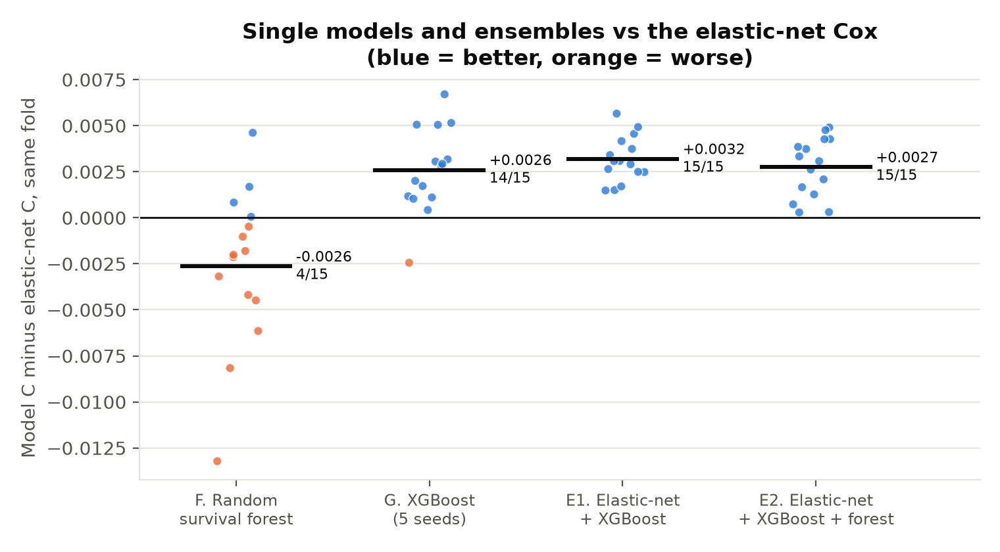
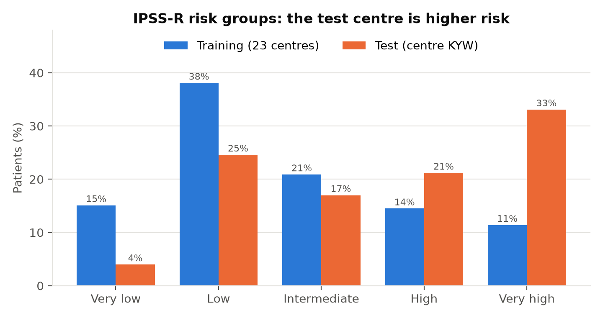
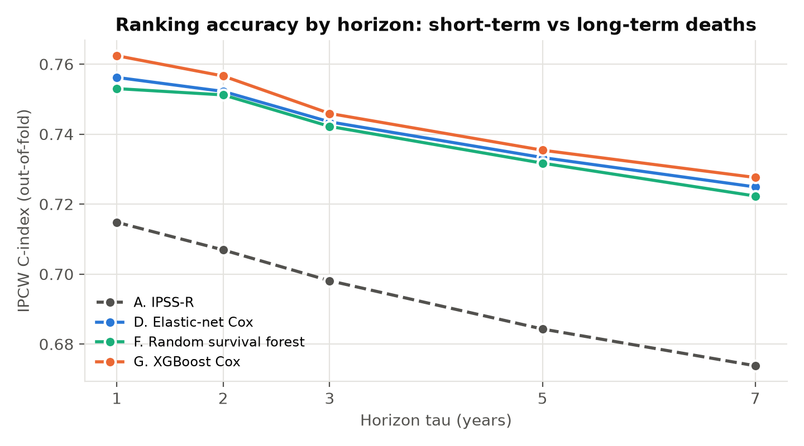

# Overall Survival Prediction in Myeloid Leukemia

Predicting how long patients with adult myeloid leukemia survive, from blood counts,
chromosome (cytogenetic) reports and gene mutations, using survival analysis:
Kaplan–Meier curves, Cox regression, and machine-learning survival models.

This is my entry to the **QRT × Institut Gustave Roussy data challenge** on
[Challenge Data (ENS Paris)](https://challengedata.ens.fr/challenges/162).

**Author:** Bernard Frimpong — M.S. Applied Mathematics (University of Akron, 2026)

---

## Results at a glance

IPCW C-index, τ = 7 years, on 15 centre-grouped validation folds (each fold holds out whole
hospitals), plus the public leaderboard score where submitted.

| Model | Cross-validation | vs elastic-net, same folds | Public score |
|---|---|---|---|
| IPSS-R clinical score (no fitting) | 0.669 ± 0.029 | −0.053 | — |
| Benchmark-style Cox (4 variables) | 0.688 ± 0.029 | −0.034 | — |
| IPSS-M-style Cox (24 variables) | 0.716 ± 0.023 | −0.006 | 0.7374 |
| Elastic-net Cox (84 features) | 0.722 ± 0.021 | — | 0.7543 |
| Random survival forest | 0.719 ± 0.021 | −0.003 (4/15 folds) | — |
| XGBoost Cox (5 seeds) | 0.724 ± 0.020 | +0.002 (13/15 folds) | *pending* |
| **Final: ensemble elastic-net + XGBoost** | **0.725 ± 0.021** | **+0.003 (15/15 folds)** | *pending* |



**Main lessons**
1. **Feature engineering did most of the work.** Literature-chosen features beat the
   benchmark variables by +0.028, while every later modelling step added at most +0.006.
2. **Validate the way you will be tested.** The test set is a hospital never seen in
   training, so all models are validated on held-out *hospitals* and compared *fold by fold*.
3. **Check the details.** Three bugs or traps were caught by looking closely: identical
   "random" CV repeats, a tuning grid that was too narrow, and XGBoost giving different
   results on Windows and Linux.

---

## The problem in one paragraph

Each patient has an observed time `OS_YEARS` and a status `OS_STATUS`
(1 = died, 0 = still alive at last follow-up, called *censored*). For censored
patients we only know they survived *at least* `OS_YEARS`. The task is to give
every test patient a **risk score**: a higher score means we expect them to die
sooner. Only the **ranking** of the scores matters.

## How the challenge scores a submission

The metric is the **IPCW concordance index** (Uno's C-index), truncated at
**7 years**, computed with `sksurv.metrics.concordance_index_ipcw`.

- Look at every pair of patients where we know who died first.
- Count the share of those pairs where the model gave the higher risk to the patient who died first.
- 0.5 = random guessing, 1.0 = perfect ranking.
- "IPCW" (inverse probability of censoring weighting) gives each such pair the weight
  1 / G(T)², where G(T) is the probability of still being followed at the time T of
  the first death. Late deaths are rarely observed, so they count more.

## Data

| File | Rows | What it contains |
|---|---|---|
| `clinical_train.csv` | 3,323 | one row per patient: centre, blood counts, cytogenetics text |
| `clinical_test.csv` | 1,193 | same, for the test patients |
| `molecular_train.csv` | 10,935 | one row per somatic mutation (gene, effect, VAF, depth) |
| `molecular_test.csv` | 3,089 | same, for the test patients |
| `target_train.csv` | 3,323 | `OS_YEARS`, `OS_STATUS` |

The data are **not** included in this repository (Challenge Data terms of use).
To reproduce the work, register for the challenge and place the five files in `data/raw/`.

## Stage 1 — data audit

1. **The test set is one new hospital** (`KYW`), never seen in the 23 training centres.
2. **The test patients are sicker:** blasts > 20% in 17.6% vs 4.2%, TP53 mutated in
   25.7% vs 11.4%.
3. **150 training patients have no outcome**, leaving 3,173 patients (1,600 deaths).
4. **Monocytes are missing for 74% of test patients** (18% in training).
5. **The karyotype text is written differently** in the two sets (`46,xy` vs `46,XY`, `Normal`).

## Stage 2 — Kaplan–Meier, log-rank tests and the metric by hand

- Kaplan–Meier computed by hand matches `lifelines` to within 2×10⁻¹⁴. Median survival
  **3.15 years**.
- Log-rank tests: blasts (χ² = 272.1), TP53 (244.6, also computed by hand), monosomy 7
  (139.5), SF3B1 (51.8, protective).
- Toy example by hand: Harrell's C = 7/9 = 0.778, IPCW C = 0.615, both matching
  `scikit-survival`.
- **Lesson:** TP53 has a huge χ² but a C-index of only 0.553 (about 75% of pairs are tied
  on a 0/1 score). Significance is not ranking power.

## Stage 3 — feature engineering

- **91 features**: log blood counts, missing flags, a forgiving karyotype parser (tested on
  25 tricky strings), mutation summaries, 45 gene indicators, and the published **IPSS-R** score.
- **Only the 64 genes sequenced in both centres** are used. The test centre seems to use a
  smaller panel. Unlabelled test splice variants were relabelled, and mutations below
  training's 2% VAF detection floor were dropped.
- **The test centre is higher risk:** 33% IPSS-R "very high" vs 11%.
- **Centre-grouped CV:** 23 centres dealt into 5 folds in random order, 3 repeats = 15 folds.
  (Bug fixed: `StratifiedGroupKFold(shuffle=True)` gave the *same* split 3 times.)



## Stage 4 — Cox regression

- h(t | x) = h₀(t) · exp(βᵀx), plus an elastic-net penalty α(ρ·Σ|βₖ| + (1−ρ)/2·Σβₖ²)
  chosen by **nested** centre-grouped CV. Imputation and scaling are learned inside each fold.
- The big gain is the feature set (+0.028 over benchmark variables). Monocytes add nothing.
- TP53 multi-hit HR **3.21**. SF3B1 is neutral once adjusted (confounding). NPM1 and
  platelets violate proportional hazards.
- **Leaderboard:** the elastic-net scores 0.7543 and the IPSS-M-style model 0.7374. The
  gap between them tripled at the test centre, where the high-risk patients that the
  extra features describe are common.


## Stage 5 — machine-learning survival models

- **Random survival forest** (300 trees): 0.719, slightly below the elastic-net.
- **XGBoost with a Cox loss**, depth and number of trees chosen by nested CV, averaged over
  5 seeds: **0.724**, +0.0024 over the elastic-net, winning 13 of 15 folds.
- **Reproducibility fix:** with the fast "histogram" method, XGBoost gave 0.7227 on Linux
  and 0.7238 on Windows (same version). It now uses the exact method on a single thread,
  so the results do not depend on the computer.
- The inner CV preferred small models: little structure is left beyond the engineered
  features. All models rank early deaths better than late ones.



## Stage 6 — ensemble, interpretation and final choice

**Ensemble.** Each model's scores are turned into ranks (0 to 1) and averaged. No refitting
is needed: the saved out-of-fold predictions are combined on the same 15 folds.

| Paired with the elastic-net (15 folds) | Mean gain | SD | Folds won |
|---|---|---|---|
| XGBoost (5 seeds) | +0.0024 | 0.0024 | 13/15 |
| **Ensemble elastic-net + XGBoost** | **+0.0030** | **0.0011** | **15/15** |
| Ensemble + random forest | +0.0027 | 0.0014 | 15/15 |

The models agree closely (Spearman 0.96–0.97 on held-out patients), so averaging helps only
a little. But the two-model ensemble is the most **consistent** model: it wins every fold.

**Permutation importance** (shuffle a group of features in held-out centres and measure the drop):


- **Mutation burden** (number of mutations and of mutated genes, max VAF, truncating
  mutations) is the strongest signal, costing about 0.04 when shuffled. That justifies
  counting only shared-panel genes.
- The elastic-net relies directly on **TP53** (0.016); XGBoost recovers most of it from
  correlated features (0.006).
- **Blasts** look unimportant only because the IPSS-R score already contains them:
  permutation importance measures what is *unique* to a group.

**Final model: the rank average of the elastic-net Cox and XGBoost Cox**, chosen by paired
cross-validation (0.725 ± 0.021, wins 15/15 folds against the elastic-net).

## Project structure

```
aml-survival-prediction/
├── README.md
├── requirements.txt
├── .gitignore
├── data/
│   ├── raw/            <- the 5 challenge CSV files go here (not on GitHub)
│   └── processed/      <- features, CV folds, out-of-fold predictions (not on GitHub)
├── src/
│   ├── config.py                    paths, 7-year horizon, random seed, colours, plot style
│   ├── load_data.py                 functions that read the files
│   ├── features.py                  karyotype parser, clinical/molecular features, IPSS-R
│   ├── cv_utils.py                  metric, CV loop, nested elastic-net and XGBoost, RSF
│   ├── 01_check_setup.py            Stage 0: checks Python, packages and data files
│   ├── 02_data_audit.py             Stage 1: data audit
│   ├── 03_kaplan_meier.py           Stage 2: KM by hand, log-rank, censoring curve
│   ├── 04_cindex_by_hand.py         Stage 2: C-index and IPCW C-index by hand
│   ├── 05_build_features.py         Stage 3: features, IPSS-R, centre-grouped CV folds
│   ├── 06_cox_models.py             Stage 4: Cox models in CV + submission files
│   ├── 07_cox_interpretation.py     Stage 4: hazard ratios, PH check, coefficients
│   ├── 08_tree_models.py            Stage 5: random survival forest, XGBoost Cox
│   ├── 09_ensemble.py               Stage 6: rank-averaged ensembles + submission files
│   └── 10_permutation_importance.py Stage 6: grouped permutation importance
├── figures/            <- PNG figures (used by the README and the paper)
├── results/tables/     <- CSV/TXT/JSON summaries
├── submissions/        <- files uploaded to Challenge Data (kept local)
└── paper/
    └── main.tex        <- LaTeX write-up, updated at every stage
```

## How to run (Windows, VS Code terminal)

```bash
py -3.13 -m venv .venv
.venv\Scripts\activate
python -m pip install --upgrade pip
pip install -r requirements.txt
pip install --no-deps scikit-survival
python src/01_check_setup.py
python src/02_data_audit.py
python src/03_kaplan_meier.py
python src/04_cindex_by_hand.py
python src/05_build_features.py
python src/06_cox_models.py
python src/07_cox_interpretation.py
python src/08_tree_models.py
python src/09_ensemble.py
python src/10_permutation_importance.py
```

Approximate times: `06` 3 minutes, `08` 6–10 minutes, `10` 2–4 minutes; the others take
seconds.

**Why `--no-deps` for scikit-survival?** It lists `ecos` as a dependency, but `ecos`
has no ready-made Windows package for Python 3.13 and would need Microsoft C++ Build
Tools to compile. `ecos` is only used by one survival-SVM function that this project
does not use, so scikit-survival is installed without it.
`xgboost-cpu` is the CPU-only build of XGBoost, a much smaller download than `xgboost`.

## Stage plan and progress

| Stage | Content | Status |
|---|---|---|
| 0 | Setup: repository, packages, data check | ✅ done |
| 1 | Data audit: linking, outcome, missing values, centres, mutations, cytogenetics | ✅ done |
| 2 | Kaplan–Meier curves, log-rank tests, C-index and IPCW C-index computed by hand | ✅ done |
| 3 | Feature engineering, IPSS-R benchmark, centre-grouped CV folds | ✅ done |
| 4 | Cox regression: benchmark, IPSS-M-style, elastic-net (nested CV), PH check | ✅ done |
| 5 | Random survival forest and XGBoost Cox (nested CV, 5 seeds), C-index by horizon | ✅ done |
| 6 | Rank-averaged ensembles, permutation importance, final model choice | ✅ done |
| 7 | Final write-up: discussion, limitations, final leaderboard scores | ⏳ next |

## Leaderboard submissions (limit: 2 per 24 hours)

| Date | File | Model | CV IPCW C-index | Public score |
|---|---|---|---|---|
| 23 Oct 2026 | `stage4_elasticnet_cox.csv` | Elastic-net Cox (84 features) | 0.722 ± 0.021 | **0.7543** |
| 23 Oct 2026 | `stage4_ipssm_cox.csv` | IPSS-M-style Cox (24 variables) | 0.716 ± 0.023 | 0.7374 |
| — | `stage5_xgboost_cox.csv` | XGBoost Cox (5 seeds) | 0.724 ± 0.020 | *pending* |
| — | `stage6_ensemble_enet_xgb.csv` | **Final: elastic-net + XGBoost** | 0.725 ± 0.021 | *pending* |

## References

- Kaplan E. L. and Meier P. (1958). Nonparametric estimation from incomplete
  observations. *Journal of the American Statistical Association* 53(282).
- Mantel N. (1966). Evaluation of survival data and two new rank order statistics
  arising in its consideration. *Cancer Chemotherapy Reports* 50(3).
- Cox D. R. (1972). Regression models and life-tables. *Journal of the Royal Statistical
  Society, Series B* 34(2).
- Harrell F. E. *et al.* (1982). Evaluating the yield of medical tests. *JAMA* 247(18).
- Grambsch P. M. and Therneau T. M. (1994). Proportional hazards tests and diagnostics
  based on weighted residuals. *Biometrika* 81(3).
- Breiman L. (2001). Random forests. *Machine Learning* 45(1).
- Friedman J. H. (2001). Greedy function approximation: a gradient boosting machine.
  *The Annals of Statistics* 29(5).
- Zou H. and Hastie T. (2005). Regularization and variable selection via the elastic net.
  *Journal of the Royal Statistical Society, Series B* 67(2).
- Ishwaran H. *et al.* (2008). Random survival forests. *The Annals of Applied
  Statistics* 2(3).
- Simon N. *et al.* (2011). Regularization paths for Cox's proportional hazards model via
  coordinate descent. *Journal of Statistical Software* 39(5).
- Uno H. *et al.* (2011). On the C-statistics for evaluating overall adequacy of risk
  prediction procedures with censored survival data. *Statistics in Medicine* 30(10).
- Greenberg P. L. *et al.* (2012). Revised International Prognostic Scoring System for
  myelodysplastic syndromes. *Blood* 120(12).
- Schanz J. *et al.* (2012). New comprehensive cytogenetic scoring system for primary
  myelodysplastic syndromes. *Journal of Clinical Oncology* 30(8).
- Chen T. and Guestrin C. (2016). XGBoost: a scalable tree boosting system.
  *Proceedings of KDD 2016*.
- Noren D. P. *et al.* (2016). A crowdsourcing approach to developing and assessing
  prediction algorithms for AML prognosis. *PLOS Computational Biology* 12(6): e1004890.
- Bernard E. *et al.* (2022). Molecular International Prognostic Scoring System for
  myelodysplastic syndromes. *NEJM Evidence* 1(7).
- Pölsterl S. (2020). scikit-survival: a library for time-to-event analysis built on
  top of scikit-learn. *Journal of Machine Learning Research* 21(212).
- Davidson-Pilon C. (2019). lifelines: survival analysis in Python. *Journal of Open
  Source Software* 4(40).
