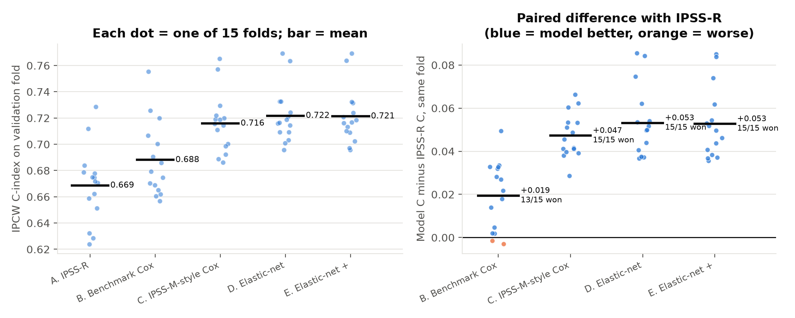
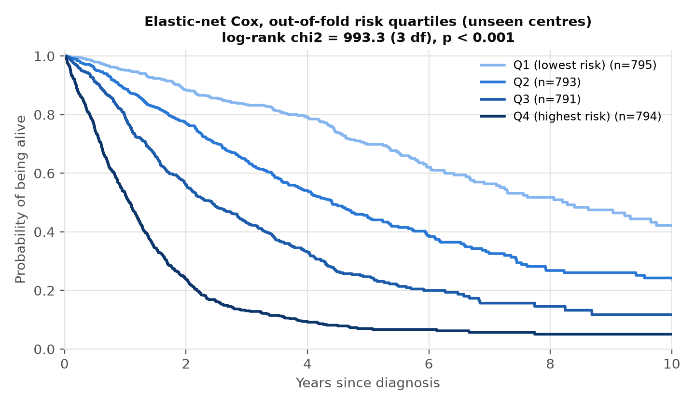

# Overall Survival Prediction in Myeloid Leukemia

Predicting how long patients with adult myeloid leukemia survive, from blood counts,
chromosome (cytogenetic) reports and gene mutations, using survival analysis:
Kaplan–Meier curves, Cox regression, and machine-learning survival models.

This is my entry to the **QRT × Institut Gustave Roussy data challenge** on
[Challenge Data (ENS Paris)](https://challengedata.ens.fr/challenges/162).

**Author:** Bernard Frimpong — M.S. Applied Mathematics (University of Akron, 2026)

---

## Results at a glance (IPCW C-index, τ = 7 years, 15 centre-grouped validation folds)

| Model | Mean ± SD | Beats IPSS-R on |
|---|---|---|
| IPSS-R clinical score (no fitting) | 0.669 ± 0.029 | — |
| Benchmark-style Cox (4 variables) | 0.688 ± 0.029 | 13/15 folds |
| IPSS-M-style Cox (24 variables) | 0.716 ± 0.023 | 15/15 folds |
| **Elastic-net Cox (84 features)** | **0.722 ± 0.021** | **15/15 folds** |



---

## The problem in one paragraph

Each patient has an observed time `OS_YEARS` and a status `OS_STATUS`
(1 = died, 0 = still alive at last follow-up, called *censored*). For censored
patients we only know they survived *at least* `OS_YEARS`. The task is to give
every test patient a **risk score**: a higher score means we expect them to die
sooner. Only the **ranking** of the scores matters.

## How the challenge scores a submission

The metric is the **IPCW concordance index** (Uno's C-index), truncated at
**7 years**, computed with `sksurv.metrics.concordance_index_ipcw`.

- Look at every pair of patients where we know who died first.
- Count the share of those pairs where the model gave the higher risk to the patient who died first.
- 0.5 = random guessing, 1.0 = perfect ranking.
- "IPCW" (inverse probability of censoring weighting) gives each such pair the weight
  1 / G(T)², where G(T) is the probability of still being followed at the time T of
  the first death. Late deaths are rarely observed, so they count more.

## Data

| File | Rows | What it contains |
|---|---|---|
| `clinical_train.csv` | 3,323 | one row per patient: centre, blood counts, cytogenetics text |
| `clinical_test.csv` | 1,193 | same, for the test patients |
| `molecular_train.csv` | 10,935 | one row per somatic mutation (gene, effect, VAF, depth) |
| `molecular_test.csv` | 3,089 | same, for the test patients |
| `target_train.csv` | 3,323 | `OS_YEARS`, `OS_STATUS` |

The data are **not** included in this repository (Challenge Data terms of use).
To reproduce the work, register for the challenge and place the five files in `data/raw/`.

## Stage 1 — data audit: key findings

1. **The test set is one new hospital.** All 1,193 test patients come from centre
   `KYW`, which never appears in the 23 training centres. So I validate by holding out
   *whole centres* (grouped cross-validation), imitating the real test situation.
2. **The test patients are sicker.** More bone-marrow blasts above 20% (17.6% vs 4.2%),
   lower platelets and haemoglobin, and more than twice the rate of **TP53** mutations
   (25.7% vs 11.4%).
3. **150 training patients have no outcome** and are removed, leaving 3,173 patients:
   1,600 deaths (50.4%) and 1,573 censored (49.6%).
4. **Monocyte counts are missing for 74% of test patients** (18% in training).
5. **The cytogenetics text is written differently** in the two sets (`46,xy` vs `46,XY`
   or `Normal`).

## Stage 2 — Kaplan–Meier, log-rank tests and the metric by hand

- Kaplan–Meier computed by hand matches `lifelines` to within 2×10⁻¹⁴.
  Median overall survival: **3.15 years**.
- Log-rank tests (all p < 0.001): blasts (χ² = 272.1), TP53 (244.6, computed by hand too),
  monosomy 7 (139.5), SF3B1 (51.8, protective).
- The censoring curve G(t) falls to 0.198 at 7 years, so a death just before 7 years
  weighs 1/0.198² ≈ 25.6 in the metric.
- On a 6-patient toy example: Harrell's C = 7/9 = 0.778 and IPCW C = 0.615, both
  matching `scikit-survival` exactly.
- **Lesson:** TP53 has a huge log-rank χ² but a C-index of only 0.553, because about 75%
  of comparable pairs are tied on a 0/1 score. Significance is not ranking power.

## Stage 3 — feature engineering

- **91 features**: clinical (log blood counts), missing flags, cytogenetic (a forgiving
  karyotype parser tested on 25 tricky strings), molecular summaries, 45 gene indicators,
  and the published **IPSS-R** score.
- **Different gene panels:** only 64 of 124 training genes appear in the test file, so all
  mutation features use the 64 shared genes. Test splice-site mutations with no label were
  relabelled, and (Stage 4) 9 test mutations below training's 2% VAF detection floor were
  dropped.
- **The test centre is higher risk:** 33% IPSS-R "very high" against 11% in training.


- **Centre-grouped CV:** 23 centres dealt into 5 folds in a random order, 3 different
  repeats = 15 validation folds. The unfitted IPSS-R scores **0.669 ± 0.029**.
- **Bug found and fixed in Stage 4:** the first version used `StratifiedGroupKFold(shuffle=True)`.
  With only 23 groups it produced the *same* split for all 3 repeats. The fold plot made
  this visible (every value appeared 3 times). The code now deals centres itself and
  checks that the repeats differ.

## Stage 4 — Cox regression

**Model.** The Cox model writes the hazard as h(t | x) = h₀(t) · exp(β₁x₁ + … + βₚxₚ).
exp(βₖ) is the hazard ratio of feature k, and the linear predictor βᵀx is the risk score
submitted. The elastic net adds the penalty α(ρ·Σ|βₖ| + (1−ρ)/2·Σβₖ²) to stop over-fitting.

**Honest evaluation.**
- Imputation and scaling sit inside a `scikit-learn` pipeline, so they are learned on each
  fold's training part only.
- The elastic-net penalty (α, ρ) is chosen by an **inner** centre-grouped CV
  (nested cross-validation).
- Models are compared **fold by fold** against the IPSS-R score.

| Comparison | Mean paired difference | Folds won |
|---|---|---|
| IPSS-M-style Cox − benchmark-style Cox | +0.028 | 14/15 |
| Elastic-net (84) − IPSS-M-style (24) | +0.006 | 10/15 |
| Elastic-net + monocytes/flags − elastic-net | −0.0004 | 4/15 |

So the big gain comes from the **feature set**. 84 penalised features add only a little
over 24 literature-chosen ones, and **monocytes add nothing**, which settles the Stage 1
concern.

**Hazard ratios** (IPSS-M-style model): TP53 multi-hit **3.21**, MLL-PTD 2.05, FLT3 1.65,
each step of the IPSS-R cytogenetic scale 1.34. Haemoglobin (0.77 per SD) and platelets
(0.83 per SD) are protective. SF3B1, protective in Kaplan–Meier, is neutral (1.02) once
other variables are included.


**Proportional hazards.** 4 of 24 variables violate the assumption (p < 0.05). NPM1 is
harmful in the first months but strongly protective later. The protective effect of
platelets is concentrated in year 1. This motivates the tree models of Stage 5.

**What 0.72 means.** Patients ranked by a model that never saw their centre: the lowest-risk
quarter has a median survival of **8.3 years**, the highest-risk quarter **1.1 years**.



## Project structure

```
aml-survival-prediction/
├── README.md
├── requirements.txt
├── .gitignore
├── data/
│   ├── raw/            <- the 5 challenge CSV files go here (not on GitHub)
│   └── processed/      <- features, CV folds, out-of-fold predictions (not on GitHub)
├── src/
│   ├── config.py               paths, 7-year horizon, random seed, colours, plot style
│   ├── load_data.py            functions that read the files
│   ├── features.py             karyotype parser, clinical/molecular features, IPSS-R
│   ├── cv_utils.py             metric, CV loop, nested elastic-net Cox, IPSS-M gene lists
│   ├── 01_check_setup.py       Stage 0: checks Python, packages and data files
│   ├── 02_data_audit.py        Stage 1: data audit
│   ├── 03_kaplan_meier.py      Stage 2: KM by hand, log-rank, censoring curve
│   ├── 04_cindex_by_hand.py    Stage 2: C-index and IPCW C-index by hand
│   ├── 05_build_features.py    Stage 3: features, IPSS-R, centre-grouped CV folds
│   ├── 06_cox_models.py        Stage 4: Cox models in CV + submission files
│   └── 07_cox_interpretation.py Stage 4: hazard ratios, PH check, coefficients
├── figures/            <- PNG figures (used by the README and the paper)
├── results/tables/     <- CSV/TXT/JSON summaries
├── submissions/        <- files uploaded to Challenge Data (kept local)
└── paper/
    └── main.tex        <- LaTeX write-up, updated at every stage
```

## How to run (Windows, VS Code terminal)

```bash
py -3.13 -m venv .venv
.venv\Scripts\activate
python -m pip install --upgrade pip
pip install -r requirements.txt
pip install --no-deps scikit-survival
python src/01_check_setup.py
python src/02_data_audit.py
python src/03_kaplan_meier.py
python src/04_cindex_by_hand.py
python src/05_build_features.py
python src/06_cox_models.py
python src/07_cox_interpretation.py
```

`06_cox_models.py` takes about 3 minutes (nested cross-validation).

**Why `--no-deps` for scikit-survival?** It lists `ecos` as a dependency, but `ecos`
has no ready-made Windows package for Python 3.13 and would need Microsoft C++ Build
Tools to compile. `ecos` is only used by one survival-SVM function that this project
does not use, so scikit-survival is installed without it.

## Stage plan and progress

| Stage | Content | Status |
|---|---|---|
| 0 | Setup: repository, packages, data check | ✅ done |
| 1 | Data audit: linking, outcome, missing values, centres, mutations, cytogenetics | ✅ done |
| 2 | Kaplan–Meier curves, log-rank tests, C-index and IPCW C-index computed by hand | ✅ done |
| 3 | Feature engineering, IPSS-R benchmark, centre-grouped CV folds | ✅ done |
| 4 | Cox regression: benchmark, IPSS-M-style, elastic-net (nested CV), PH check, first submission | ✅ done |
| 5 | Machine-learning survival models: gradient-boosted survival, random survival forest | ⏳ next |
| 6 | Model comparison, ensemble, interpretation, final submission | ⬜ |
| 7 | Final write-up | ⬜ |

## Leaderboard submissions

| Date | File | Model | CV IPCW C-index | Public score |
|---|---|---|---|---|
| Oct 2026 | `stage4_elasticnet_cox.csv` | Elastic-net Cox (84 features) | 0.722 ± 0.021 | *to be added* |

## References

- Kaplan E. L. and Meier P. (1958). Nonparametric estimation from incomplete
  observations. *Journal of the American Statistical Association* 53(282).
- Mantel N. (1966). Evaluation of survival data and two new rank order statistics
  arising in its consideration. *Cancer Chemotherapy Reports* 50(3).
- Cox D. R. (1972). Regression models and life-tables. *Journal of the Royal Statistical
  Society, Series B* 34(2).
- Harrell F. E. *et al.* (1982). Evaluating the yield of medical tests. *JAMA* 247(18).
- Grambsch P. M. and Therneau T. M. (1994). Proportional hazards tests and diagnostics
  based on weighted residuals. *Biometrika* 81(3).
- Zou H. and Hastie T. (2005). Regularization and variable selection via the elastic net.
  *Journal of the Royal Statistical Society, Series B* 67(2).
- Simon N. *et al.* (2011). Regularization paths for Cox's proportional hazards model via
  coordinate descent. *Journal of Statistical Software* 39(5).
- Uno H. *et al.* (2011). On the C-statistics for evaluating overall adequacy of risk
  prediction procedures with censored survival data. *Statistics in Medicine* 30(10).
- Greenberg P. L. *et al.* (2012). Revised International Prognostic Scoring System for
  myelodysplastic syndromes. *Blood* 120(12).
- Schanz J. *et al.* (2012). New comprehensive cytogenetic scoring system for primary
  myelodysplastic syndromes. *Journal of Clinical Oncology* 30(8).
- Noren D. P. *et al.* (2016). A crowdsourcing approach to developing and assessing
  prediction algorithms for AML prognosis. *PLOS Computational Biology* 12(6): e1004890.
- Bernard E. *et al.* (2022). Molecular International Prognostic Scoring System for
  myelodysplastic syndromes. *NEJM Evidence* 1(7).
- Pölsterl S. (2020). scikit-survival: a library for time-to-event analysis built on
  top of scikit-learn. *Journal of Machine Learning Research* 21(212).
- Davidson-Pilon C. (2019). lifelines: survival analysis in Python. *Journal of Open
  Source Software* 4(40).
