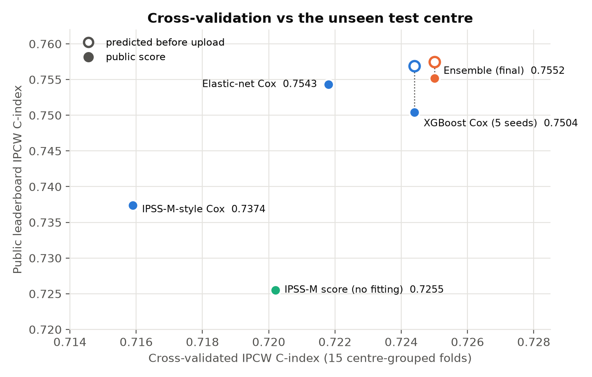
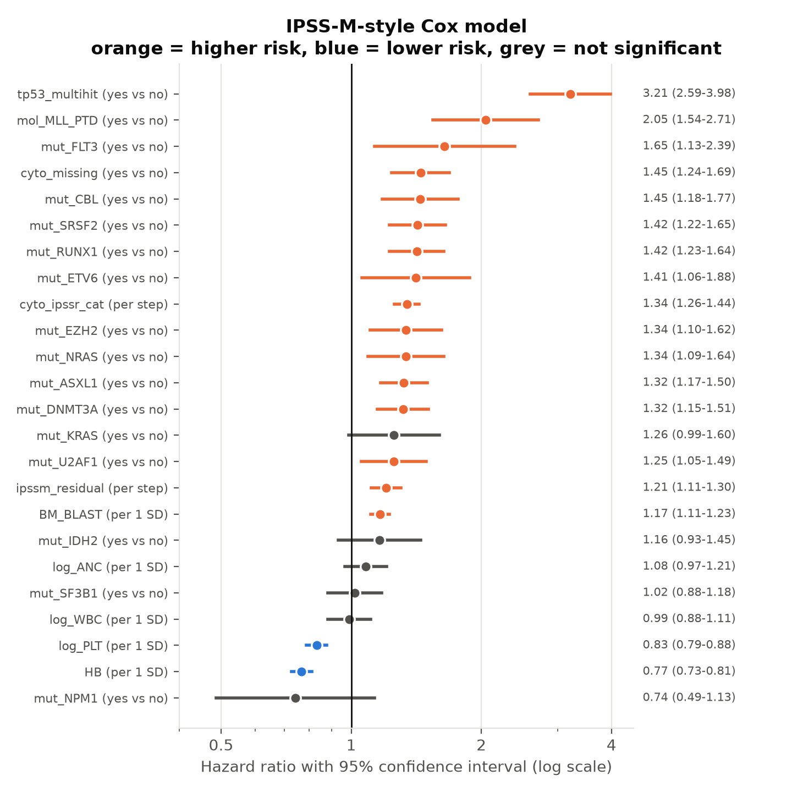
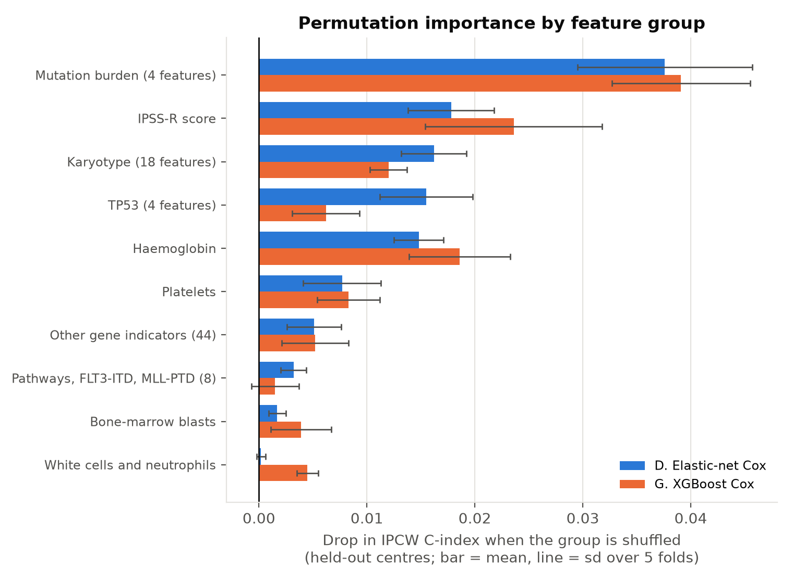

# Overall Survival Prediction in Myeloid Leukemia

Predicting how long patients with adult myeloid leukemia survive, from blood counts,
chromosome (cytogenetic) reports and gene mutations, using survival analysis:
Kaplan–Meier curves, Cox regression, gradient-boosted survival models and an ensemble,
validated on hospitals the models have never seen.

My entry to the **QRT × Institut Gustave Roussy data challenge** on
[Challenge Data (ENS Paris)](https://challengedata.ens.fr/challenges/162).
The full write-up is in [`paper/main.tex`](paper/main.tex) (43 pages, 28 figures).

**Author:** Bernard Frimpong, M.S. Applied Mathematics (University of Akron, 2026)

---

## Results

IPCW C-index (the challenge metric, τ = 7 years). Cross-validation uses 15 folds that each
hold out whole hospitals. The public score is the leaderboard result on the unseen test hospital.

| Model | Cross-validation | vs elastic-net, same folds | Public score |
|---|---|---|---|
| IPSS-R clinical score (no fitting) | 0.669 ± 0.029 | −0.053 | — |
| **IPSS-M clinical score (no fitting, published weights)** | **0.720 ± 0.023** | −0.002 | *pending* |
| Benchmark-style Cox (4 variables) | 0.688 ± 0.029 | −0.034 | — |
| IPSS-M-style Cox (24 variables) | 0.716 ± 0.023 | −0.006 | 0.7374 |
| Elastic-net Cox (84 features) | 0.722 ± 0.021 | — | 0.7543 |
| Random survival forest | 0.719 ± 0.021 | −0.003 (wins 4/15) | — |
| XGBoost Cox (5 seeds) | 0.724 ± 0.020 | +0.003 (wins 14/15) | 0.7504 |
| **Final: ensemble elastic-net + XGBoost** | **0.725 ± 0.021** | **+0.003 (wins 15/15)** | **0.7552** |



**Key findings**
1. **Feature engineering did most of the work.** Literature-chosen features added +0.028 over
   the benchmark variables. Every later modelling step added at most +0.006.
2. **The final model was chosen before its public score was known**, by paired
   cross-validation. It turned out best on the unseen hospital too, within 0.002 of the
   score I predicted before uploading.
3. **The ensemble protected against a bad surprise.** XGBoost alone won 14 of 15 folds but
   scored *below* the elastic-net at the test hospital. Averaging the two still came out on top.
4. **Mutation burden is the strongest signal.** It's the number of mutated genes and their
   VAF, counted only on genes sequenced in *both* hospitals.
5. **Honest benchmark: the published IPSS-M is as good.** With no fitting at all, the IPSS-M
   reaches 0.720. The final ensemble is ahead by only +0.005 (corrected 95% CI −0.005 to
   +0.014), and the recalibrated IPSS-M is slightly better calibrated. This work reproduces
   the clinical standard from the challenge data; it does not beat it.

## Skills demonstrated

- **Survival analysis:** Kaplan–Meier and log-rank tests (also computed by hand), Cox
  proportional hazards, hazard ratios, Schoenfeld-residual checks, elastic-net Cox,
  random survival forests, gradient boosting with a Cox loss.
- **Evaluation:** IPCW C-index computed by hand and checked against `scikit-survival`,
  hospital-grouped and nested cross-validation, paired fold-by-fold comparisons,
  corrected resampled t-test confidence intervals, time-dependent AUC, Brier score,
  calibration, permutation importance on held-out data.
- **Clinical benchmarking:** the IPSS-M implemented from its published weights and verified
  against the official calculator (300 of 300 patients identical).
- **Messy real data:** a forgiving parser for free-text karyotypes (ISCN), harmonising gene
  panels and mutation labels between hospitals, missing values handled inside each fold.
- **Reproducibility:** fixed seeds, scripts run in order from raw data, results verified on a
  fresh copy and across Windows and Linux.

## What I did, stage by stage

| Stage | What | Highlights |
|---|---|---|
| 1 | Data audit | The test set is one *new* hospital and its patients are sicker (TP53 mutated 25.7% vs 11.4%). Monocytes are missing for 74% of test patients. |
| 2 | Kaplan–Meier and the metric by hand | Median survival 3.15 years. Log-rank TP53 χ² = 244.6 (by hand). Toy IPCW C = 0.615, matching `scikit-survival`. |
| 3 | Feature engineering | 91 features, a karyotype parser tested on 25 tricky strings, a 64-gene shared panel, the IPSS-R score, and 15 hospital-grouped folds. |
| 4 | Cox regression | Nested elastic-net. TP53 multi-hit HR 3.21. SF3B1 is neutral once adjusted (confounding). NPM1 and platelets violate proportional hazards. |
| 5 | Tree models | Random survival forest and XGBoost Cox (nested tuning, 5 seeds). Small, consistent gains. C-index falls with the horizon. |
| 6 | Ensemble and interpretation | A rank-averaged ensemble wins 15/15 folds. Grouped permutation importance: mutation burden first. |
| 7 | External validation and write-up | Predictions recorded before upload. A tested-and-rejected explanation for XGBoost's drop. Discussion and limitations. |
| 8 | Benchmarks, uncertainty, calibration | IPSS-M benchmark (verified), corrected CIs, time-dependent AUC, Brier score, calibration, Table 1. |

**Problems caught by checking the details:** the three "random" CV repeats were identical (a
`StratifiedGroupKFold` pitfall with only 23 groups); a tuning grid was too narrow; and
XGBoost gave different results on Windows and Linux (now 0.0002 apart after switching to
exact split-finding and averaging 5 seeds).





## How the challenge scores a submission

Each patient has an observed time `OS_YEARS` and a status `OS_STATUS` (1 = died, 0 = alive
at last follow-up, *censored*). A model gives each patient a **risk score**, and only the
**ranking** matters. The **IPCW concordance index** looks at every pair of patients where we
know who died first, and counts the share where the model gave that patient the higher risk.
Each pair is weighted by 1 / G(T)², where G(T) is the probability of still being followed at
the time T of the first death, so late deaths (rarely observed) count more. Pairs are only
counted up to 7 years. 0.5 is random guessing and 1.0 is perfect.

## Data

| File | Rows | What it contains |
|---|---|---|
| `clinical_train.csv` | 3,323 | one row per patient: centre, blood counts, cytogenetics text |
| `clinical_test.csv` | 1,193 | same, for the test patients |
| `molecular_train.csv` | 10,935 | one row per somatic mutation (gene, effect, VAF, depth) |
| `molecular_test.csv` | 3,089 | same, for the test patients |
| `target_train.csv` | 3,323 | `OS_YEARS`, `OS_STATUS` |

The data are **not** included in this repository (Challenge Data terms of use).
To reproduce the work, register for the challenge and place the five files in `data/raw/`.

## Project structure

```
aml-survival-prediction/
├── README.md
├── requirements.txt
├── .gitignore
├── data/
│   ├── raw/            <- the 5 challenge CSV files go here (not on GitHub)
│   └── processed/      <- features, CV folds, out-of-fold predictions (not on GitHub)
├── src/
│   ├── config.py                    paths, 7-year horizon, random seed, colours, plot style
│   ├── load_data.py                 functions that read the files
│   ├── features.py                  karyotype parser, clinical/molecular features, IPSS-R
│   ├── cv_utils.py                  metric, CV loop, nested elastic-net and XGBoost, RSF
│   ├── 01_check_setup.py            Stage 0: checks Python, packages and data files
│   ├── 02_data_audit.py             Stage 1: data audit
│   ├── 03_kaplan_meier.py           Stage 2: KM by hand, log-rank, censoring curve
│   ├── 04_cindex_by_hand.py         Stage 2: C-index and IPCW C-index by hand
│   ├── 05_build_features.py         Stage 3: features, IPSS-R, hospital-grouped CV folds
│   ├── 06_cox_models.py             Stage 4: Cox models in CV + submission files
│   ├── 07_cox_interpretation.py     Stage 4: hazard ratios, PH check, coefficients
│   ├── 08_tree_models.py            Stage 5: random survival forest, XGBoost Cox
│   ├── 09_ensemble.py               Stage 6: rank-averaged ensembles + submission files
│   ├── 10_permutation_importance.py Stage 6: grouped permutation importance
│   ├── 11_final_summary.py          Stage 7: leaderboard record, TP53 co-occurrence, subgroups
│   ├── ipssm.py                     Stage 8: IPSS-M score from published weights
│   ├── 12_ipssm_benchmark.py        Stage 8: IPSS-M in CV + submission file
│   ├── 13_uncertainty_calibration.py Stage 8: corrected CIs, time-dependent AUC, Brier, calibration
│   └── 14_table1.py                 Stage 8: cohort characteristics (Table 1)
├── figures/            <- 28 PNG figures (used by the README and the paper)
├── results/tables/     <- CSV/TXT/JSON summaries
├── submissions/        <- files uploaded to Challenge Data (kept local)
└── paper/
    └── main.tex        <- the full LaTeX write-up
```

## How to run (Windows, VS Code terminal)

```bash
py -3.13 -m venv .venv
.venv\Scripts\activate
python -m pip install --upgrade pip
pip install -r requirements.txt
pip install --no-deps scikit-survival
python src/01_check_setup.py
python src/02_data_audit.py
python src/03_kaplan_meier.py
python src/04_cindex_by_hand.py
python src/05_build_features.py
python src/06_cox_models.py
python src/07_cox_interpretation.py
python src/08_tree_models.py
python src/09_ensemble.py
python src/10_permutation_importance.py
python src/11_final_summary.py
python src/12_ipssm_benchmark.py
python src/13_uncertainty_calibration.py
python src/14_table1.py
```

Approximate times: `06` 3 minutes, `08` 6–10 minutes, `10` 2–4 minutes, `13` about 1 minute;
the others take seconds.

**Why `--no-deps` for scikit-survival?** It lists `ecos` as a dependency, but `ecos` has no
ready-made Windows package for Python 3.13 and would need Microsoft C++ Build Tools to
compile. `ecos` is only used by one survival-SVM function that this project does not use.
`xgboost-cpu` is the CPU-only build of XGBoost, a much smaller download than `xgboost`.

## Leaderboard submissions (limit: 2 per 24 hours)

Each prediction was written down **before** uploading: the elastic-net's public score plus
the model's paired cross-validation gain.

| Date | File | Model | CV | Predicted | Public |
|---|---|---|---|---|---|
| 23 Oct 2026 | `stage4_elasticnet_cox.csv` | Elastic-net Cox | 0.7218 | — | 0.7543 |
| 23 Oct 2026 | `stage4_ipssm_cox.csv` | IPSS-M-style Cox | 0.7159 | — | 0.7374 |
| 24 Oct 2026 | `stage6_ensemble_enet_xgb.csv` | **Ensemble (final)** | 0.7250 | 0.7575 | **0.7552** |
| 24 Oct 2026 | `stage5_xgboost_cox.csv` | XGBoost Cox (5 seeds) | 0.7244 | 0.7569 | 0.7504 |
| — | `stage8_ipssm_score.csv` | IPSS-M score (no fitting) | 0.7202 | *to record* | *pending* |

## Limitations

The training data very probably overlap with the cohort used to build the IPSS-M, so its
scores here may be optimistic. There is only one external hospital, and only part of it is
scored publicly. The test
hospital is much sicker than training, and the models were not adapted to it. Gene panels
differ between hospitals (60 training genes unused). The karyotype parser is rule-based. The
metric assumes censoring is unrelated to prognosis. There is no treatment or age
information. The benchmark was reconstructed from the challenge description. Details are
in the paper.

## References

- Kaplan E. L. and Meier P. (1958). Nonparametric estimation from incomplete
  observations. *Journal of the American Statistical Association* 53(282).
- Mantel N. (1966). Evaluation of survival data and two new rank order statistics
  arising in its consideration. *Cancer Chemotherapy Reports* 50(3).
- Cox D. R. (1972). Regression models and life-tables. *Journal of the Royal Statistical
  Society, Series B* 34(2).
- Harrell F. E. *et al.* (1982). Evaluating the yield of medical tests. *JAMA* 247(18).
- Grambsch P. M. and Therneau T. M. (1994). Proportional hazards tests and diagnostics
  based on weighted residuals. *Biometrika* 81(3).
- Breiman L. (2001). Random forests. *Machine Learning* 45(1).
- Friedman J. H. (2001). Greedy function approximation: a gradient boosting machine.
  *The Annals of Statistics* 29(5).
- Zou H. and Hastie T. (2005). Regularization and variable selection via the elastic net.
  *Journal of the Royal Statistical Society, Series B* 67(2).
- Ishwaran H. *et al.* (2008). Random survival forests. *The Annals of Applied
  Statistics* 2(3).
- Simon N. *et al.* (2011). Regularization paths for Cox's proportional hazards model via
  coordinate descent. *Journal of Statistical Software* 39(5).
- Uno H. *et al.* (2011). On the C-statistics for evaluating overall adequacy of risk
  prediction procedures with censored survival data. *Statistics in Medicine* 30(10).
- Greenberg P. L. *et al.* (2012). Revised International Prognostic Scoring System for
  myelodysplastic syndromes. *Blood* 120(12).
- Schanz J. *et al.* (2012). New comprehensive cytogenetic scoring system for primary
  myelodysplastic syndromes. *Journal of Clinical Oncology* 30(8).
- Chen T. and Guestrin C. (2016). XGBoost: a scalable tree boosting system.
  *Proceedings of KDD 2016*.
- Noren D. P. *et al.* (2016). A crowdsourcing approach to developing and assessing
  prediction algorithms for AML prognosis. *PLOS Computational Biology* 12(6): e1004890.
- Bernard E. *et al.* (2022). Molecular International Prognostic Scoring System for
  myelodysplastic syndromes. *NEJM Evidence* 1(7).
- Pölsterl S. (2020). scikit-survival: a library for time-to-event analysis built on
  top of scikit-learn. *Journal of Machine Learning Research* 21(212).
- Davidson-Pilon C. (2019). lifelines: survival analysis in Python. *Journal of Open
  Source Software* 4(40).
